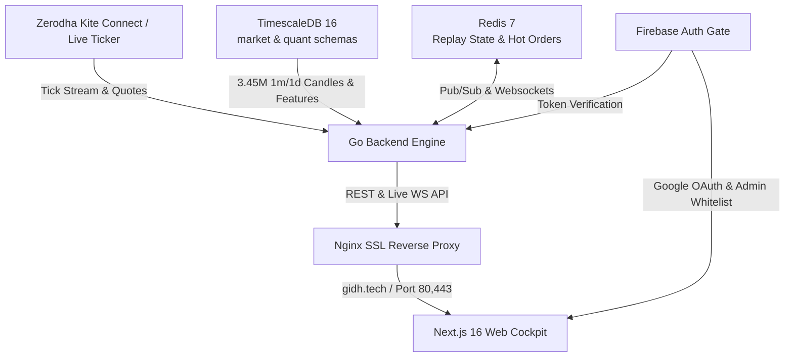

# Gidh Intraday Architecture & Documentation Index

## 1. System Overview
Gidh Intraday is an institutional-grade, zero-latency quantitative market terminal, replay simulator, and live MIS trade execution engine designed for the Indian equity and derivatives markets (NSE & NFO).



---

## 2. Core Documentation Modules

| Document | Purpose & Scope |
| :--- | :--- |
| [PRODUCT.md](PRODUCT.md) | Product mission, positioning, single-responsibility rules, 5-slot MIS model |
| [DESIGN.md](DESIGN.md) | Monochrome design tokens, typography, dark/light palette, micro-border rules |
| [UNIVERSE.md](UNIVERSE.md) | 210-stock F&O active universe contract, dual-token cash/futures architecture |
| [AGENTS.md](AGENTS.md) | Developer contract, code ownership rules, ponytail comments, verification standard |

---

## 3. Database Schema Ownership (`TimescaleDB`)

### `market` Schema
- `market.instruments`: Authoritative 210 active NSE F&O equities, cash tokens, lot sizes, and sector taxonomy.
- `market.cash_candles_1m`: Hypertable containing 3.45M+ 1-minute historical OHLCV bars.
- `market.cash_candles_1d`: Daily OHLCV bars (250 bars per symbol).
- `market.daily_features`: Pre-computed pre-market baselines (ATR, 5d/20d returns, RVOL dryup, historical basis).
- `market.intraday_features_1m`: Hypertable tracking 1-minute roll-forward features (session VWAP, RVOL, CLV, MFE/MAE).
- `market.feature_runs`: Audit log of batch feature computations.

### `quant` Schema
- `quant.sessions`: Calendar of traded market sessions with metadata.
- `quant.brain_rules`: Deterministic algorithmic trading protocols (e.g. `RVOL_SURGE_ENTRY`, `STOP_FLOOR_COLLAR`).
- `quant.trades` & `quant.reviews`: Post-session trade journals and performance checkpoints.

---

## 4. API Endpoints & Protocols

### Market & Replay Endpoints (`readapi`)
- `GET /healthz`: Healthcheck status (`{"status":"ok"}`).
- `GET /v1/market/universe`: 210 active stock list with sector mappings and tokens.
- `GET /v1/market/sessions`: Traded session date list.
- `GET /v1/market/daily-features?session_date=YYYY-MM-DD`: Daily baseline feature table.
- `GET /v1/market/intraday-features?session_date=YYYY-MM-DD&symbol=SYM`: 1-minute intraday roll-forward features.
- `GET /v1/replay/snapshot?session_date=YYYY-MM-DD&minute=MIN`: Market-wide snapshot for Radar and Sectors terminals.
- `GET /v1/replay/candles?session_date=YYYY-MM-DD&symbol=SYM&to_time=HH:MM:SS&interval=5m`: Lightweight-charts candlestick feed.
- `GET /v1/replay/ws`: High-frequency replay WebSocket broadcaster.

### Orders & Execution Endpoints (`ordermanager`)
- `GET /v1/live/orders`: Returns current active positions and used slots (0-5).
- `POST /v1/live/orders`: Submits an MIS market order (₹10,000 margin / ₹50,000 gross exposure).
- `POST /v1/live/orders/square-off`: Closes an active position and liquidates the slot.
- `GET /v1/live/orders/ws`: Real-time order update and tick-by-tick P&L stream.

---

## 5. Security & Authentication Architecture
1. **Frontend Gate**: Next.js `AuthGate` requires Google Authentication via Firebase SDK.
2. **Backend Gate**: Go `AuthMiddleware` verifies Firebase ID tokens via the Firebase Admin SDK (`FIREBASE_CREDENTIALS_B64`).
3. **Admin Whitelist**: Strict 2-admin email whitelist (`manujkathuria1912@gmail.com`, `manujkathuria000@gmail.com`).
4. **Environment Isolation**:
   - `ENV=development`: Runs locally in offline paper trading mode with mock broker orders.
   - `ENV=production`: Connects to Zerodha Kite API and live ticker stream on the VM.

---

## 6. Development & Deployment Commands

```bash
# Local Development
make web            # Starts Next.js War Room UI on http://localhost:3000
make api            # Starts Go API on http://localhost:8080 (Paper Trading)
make api-restart    # Restarts Go API
make universe       # Syncs 210 F&O instruments
make test           # Runs backend unit tests

# Production VM Operations
docker compose -f docker-compose.prod.yml up -d --build  # Full stack rebuild & deploy
```
