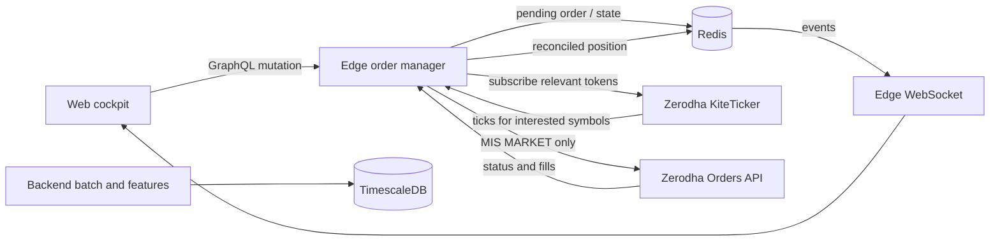

# Edge Order Manager Implementation Plan

Status: Proposed  
Audience: Edge, market-data, frontend, and operations developers  
Scope: Redis-managed synthetic limit orders and Zerodha MIS market execution

## 1. Objective

Move the complete live-order lifecycle into the Go edge service. The edge must:

- expose separate market-order and synthetic limit-order APIs;
- keep pending synthetic orders and the operational position view in Redis;
- subscribe only to ticks for symbols that have pending orders or active positions;
- send only `MARKET` orders to Zerodha;
- reconcile every submitted broker order against Zerodha before treating it as filled;
- publish state changes to the cockpit; and
- recover safely after a restart without placing duplicate orders.

The backend remains responsible for historical market data, candles, features, and batch jobs. It must not place broker orders or independently mutate live-order state.

## 2. Non-negotiable invariants

1. The edge order manager is the only writer allowed to place, exit, or reconcile Zerodha orders.
2. A GraphQL resolver must never write live order or position records directly to Redis. It calls the order-manager service.
3. Zerodha receives only MIS `MARKET` orders. A limit order in this system is a synthetic trigger stored in Redis.
4. Redis is authoritative for an untriggered synthetic order. Zerodha is authoritative after a broker order has been submitted.
5. A broker acknowledgement is not a fill. A position becomes `ACTIVE` only after the broker reports a completed fill and average price.
6. Every entry uses the fixed risk contract:
   - maximum adverse excursion: 1.0% from actual fill price;
   - target: 2R, which is 2.0% from actual fill price;
   - long: stop `fill * 0.99`, target `fill * 1.02`;
   - short: stop `fill * 1.01`, target `fill * 0.98`.
7. Triggering and order submission must be idempotent. Concurrent ticks, client retries, and process restarts must not produce duplicate broker orders.
8. A broker timeout or ambiguous response must move the order to `RECONCILE_REQUIRED`; it must not be retried blindly.
9. New entries are blocked when market data is stale, reconciliation has failed, the kill switch is active, or risk limits would be exceeded.
10. Live-order APIs and WebSockets require authenticated, authorised users. Production must not permit anonymous requests or unrestricted WebSocket origins.

## 3. Target architecture



The edge runs one order manager and one execution-focused ticker connection. The ticker subscribes dynamically to the union of:

- instrument tokens referenced by `PENDING` synthetic limit orders; and
- instrument tokens referenced by active positions whose P&L, stop, or target must be evaluated.

It does not need every tick for the full stock universe.

## 4. Edge package ownership

Create the following edge packages, adapting the existing backend implementation rather than maintaining two copies:

```text
edge/internal/broker/
  broker.go              Broker interface and broker-domain responses
  kite.go                Zerodha adapter and API rate limiting

edge/internal/ordermanager/
  manager.go             Lifecycle orchestration and locking
  types.go               Order, position, status, and request types
  validation.go          Session, symbol, risk, and input checks
  market_order.go        Immediate entry workflow
  limit_order.go         Synthetic limit creation and cancellation
  trigger.go             Tick evaluation and atomic trigger claim
  exits.go               Stop, target, and manual square-off workflow
  reconcile.go           Broker status and position reconciliation
  redis_store.go         Redis persistence and atomic transitions
  events.go              Durable and real-time event publication
  subscriptions.go       Interested-token reference tracking
```

Wire a single manager instance in `edge/cmd/edge/main.go` and inject it into `graph.Resolver`. GraphQL resolvers should only translate API inputs and outputs.

Use an interface around Zerodha so lifecycle tests do not call the real broker:

```go
type Broker interface {
    PlaceMISMarketOrder(ctx context.Context, req MarketOrderRequest) (BrokerOrder, error)
    GetOrder(ctx context.Context, orderID string) (BrokerOrder, error)
    GetOrders(ctx context.Context) ([]BrokerOrder, error)
    GetPositions(ctx context.Context) ([]BrokerPosition, error)
}
```

## 5. GraphQL contract

Replace the ambiguous `createOrder` mutation with explicit operations. Use generated GraphQL types; do not expose Redis records directly.

```graphql
enum TradeSide {
  LONG
  SHORT
}

enum ManagedOrderType {
  MARKET
  SYNTHETIC_LIMIT
}

enum ManagedOrderStatus {
  PENDING
  TRIGGERING
  SUBMITTING
  SUBMITTED
  FILLED
  REJECTED
  CANCELLED
  RECONCILE_REQUIRED
  EXIT_SUBMITTED
  CLOSED
}

input PlaceMarketOrderInput {
  clientOrderId: ID!
  symbol: String!
  side: TradeSide!
  marginInr: Float!
  tactic: String
  invalidation: String!
}

input PlaceLimitOrderInput {
  clientOrderId: ID!
  symbol: String!
  side: TradeSide!
  limitPrice: Float!
  marginInr: Float!
  tactic: String
  invalidation: String!
}

type ManagedOrder {
  id: ID!
  clientOrderId: ID!
  brokerOrderId: String
  orderType: ManagedOrderType!
  status: ManagedOrderStatus!
  symbol: String!
  exchange: String!
  side: TradeSide!
  quantity: Int!
  limitPrice: Float
  expectedStopPrice: Float
  expectedTargetPrice: Float
  actualFillPrice: Float
  stopPrice: Float
  targetPrice: Float
  rejectionReason: String
  createdAt: String!
  updatedAt: String!
}

type Mutation {
  placeMarketOrder(input: PlaceMarketOrderInput!): ManagedOrder!
  placeLimitOrder(input: PlaceLimitOrderInput!): ManagedOrder!
  cancelLimitOrder(id: ID!): ManagedOrder!
  squareOffPosition(symbol: String!, reason: String!): ManagedOrder!
}
```

`clientOrderId` is generated once by the client and reused for retries. The server returns the previously created order when it receives the same ID with the same payload. Reuse with a different payload is rejected.

The market-order mutation may return `SUBMITTED`. It must not claim `FILLED` until reconciliation confirms the fill.

## 6. Redis model

Use one canonical prefix and constants shared by all edge order-manager code.

| Key | Type | Purpose |
| --- | --- | --- |
| `gidh-intraday:live:orders` | Hash | Managed orders keyed by internal order ID |
| `gidh-intraday:live:positions` | Hash | Reconciled active positions keyed by symbol |
| `gidh-intraday:live:client-orders` | Hash | `clientOrderId` to internal order ID mapping |
| `gidh-intraday:live:interested-tokens` | Set | Tokens requiring live tick subscription |
| `gidh-intraday:live:risk` | String/JSON | Current risk and kill-switch state |
| `gidh-intraday:live:order-events` | Stream | Durable lifecycle and audit events |
| `gidh-intraday:live:events` | Pub/Sub | Low-latency cockpit notifications |

Each order record must include at least:

- internal ID and client order ID;
- broker order ID and broker tag when available;
- symbol, instrument token, exchange, side, quantity, and type;
- limit price, actual fill price, stop, and target;
- status and monotonically increasing revision;
- trigger timestamp, submission timestamp, fill timestamp, and update timestamp;
- rejection or reconciliation message; and
- tactic, invalidation, and initiating user identity.

Redis writes that change lifecycle state must also append an event to the durable stream. Use a transaction or Lua script when the record and event must change together.

## 7. State machines

### Market entry

```text
SUBMITTING → SUBMITTED → FILLED
     │            │
     ├────────────┴──→ RECONCILE_REQUIRED
     └───────────────→ REJECTED
```

### Synthetic limit entry

```text
PENDING → TRIGGERING → SUBMITTING → SUBMITTED → FILLED
   │          │             │            │
   └→ CANCELLED             └────────────┴→ RECONCILE_REQUIRED
                                        └→ REJECTED
```

Only the `PENDING → TRIGGERING` winner may call Zerodha. Implement this as an atomic compare-and-set on status and revision. A normal process mutex is insufficient because restarts or multiple edge instances may exist.

### Position exit

```text
ACTIVE → EXIT_SUBMITTED → CLOSED
             │
             └→ RECONCILE_REQUIRED
```

A position must remain visible while its exit is merely submitted. Remove it only when Zerodha confirms that the exit filled or broker reconciliation proves the position is flat.

## 8. Order workflows

### 8.1 Market order

1. Authenticate and authorise the caller.
2. Validate the client order ID, side, symbol, active-universe membership, market session, data freshness, risk state, available slot, and margin.
3. Resolve the instrument token and exchange from the instrument repository.
4. Obtain a recent quote and compute quantity using configured leverage. Reject stale or invalid prices; never use a hard-coded fallback price.
5. Atomically reserve the client order ID, slot, and intended exposure in Redis.
6. Persist a `SUBMITTING` order and audit event.
7. Send one Zerodha MIS market order with a traceable tag.
8. Persist the returned broker order ID and move to `SUBMITTED`.
9. Poll or consume broker updates until `COMPLETE`, `REJECTED`, `CANCELLED`, or timeout.
10. On `COMPLETE`, use the broker average price, calculate the fixed stop and 2R target, create the active position, and mark the order `FILLED`.
11. On an ambiguous result, set `RECONCILE_REQUIRED`, block another entry for that symbol, and reconcile before allowing retry.

### 8.2 Synthetic limit order

1. Run the same authentication, symbol, session, risk, price, and slot validation.
2. Validate limit direction against a fresh quote when required by product rules.
3. Calculate quantity using the limit price for reservation purposes.
4. Store the order as `PENDING`; do not call Zerodha.
5. Add the instrument token to the subscription manager.
6. For each relevant tick:
   - long entry triggers when `LTP <= limitPrice`;
   - short entry triggers when `LTP >= limitPrice`.
7. Atomically claim `PENDING → TRIGGERING`.
8. Submit one Zerodha market order and follow the market-order reconciliation workflow.
9. Recalculate stop and target from the actual broker fill, not the requested limit or triggering tick.

Pending orders survive process restarts. On startup, the manager loads them from Redis, rebuilds the interested-token set, subscribes before accepting new mutations, and reconciles any non-terminal order.

### 8.3 Stops, targets, and manual exits

Stops and targets remain synthetic. When a relevant tick crosses either level, the edge atomically claims the exit and sends an opposite-side Zerodha market order.

The same duplicate-prevention and reconciliation requirements used for entries apply to exits. A failure to submit an exit is critical and must emit a high-priority alert while retaining the position in Redis.

## 9. Selective tick subscriptions

The subscription manager maintains reference counts by instrument token:

```text
token needed by pending order  ┐
                               ├─ count > 0: subscribed
token needed by active position┘
                                  count = 0: unsubscribe
```

Requirements:

- subscribe when the first pending order or active position references a token;
- unsubscribe only when no pending order or active position references it;
- update the in-memory latest-tick cache before calling the order manager;
- reject new orders when the latest tick or quote exceeds the configured staleness limit;
- restore subscriptions from Redis on startup and reconnect; and
- serialize subscription changes so reconnects cannot lose tokens.

Do not query all Redis orders on every tick. Keep an in-memory symbol-to-order index, update it on lifecycle changes, and rebuild it from Redis during startup.

## 10. Reconciliation and recovery

Reconciliation runs:

- during edge startup before accepting order mutations;
- after every broker submission;
- periodically while the market is open;
- after ticker or broker API reconnects;
- whenever a submission response is ambiguous; and
- on explicit operator request.

Rules:

- broker positions and completed fills override conflicting Redis position data;
- a broker order found by stored broker ID or unique tag is attached to its managed order;
- an unexpected broker position is imported as `BROKER_DISCOVERED` and blocks new entries until reviewed;
- a Redis active position absent at the broker is closed locally with a reconciliation event;
- an unresolved mismatch activates a symbol-level hold; systemic failure activates the global kill switch; and
- never automatically resubmit solely because the edge did not receive a response.

## 11. Events and WebSocket contract

Publish a consistent envelope on `gidh-intraday:live:events`:

```json
{
  "type": "ORDER_STATUS_CHANGED",
  "timestamp": "2026-09-19T10:15:30+05:30",
  "payload": {
    "id": "ord_...",
    "status": "FILLED",
    "symbol": "RELIANCE"
  }
}
```

Supported event categories should include:

- `ORDER_CREATED`;
- `ORDER_TRIGGERED`;
- `ORDER_STATUS_CHANGED`;
- `POSITION_OPENED`;
- `POSITION_UPDATED`;
- `POSITION_CLOSED`;
- `RECONCILIATION_REQUIRED`;
- `RISK_STATE_CHANGED`; and
- `EXECUTION_ALERT`.

The edge WebSocket hub must subscribe to this exact channel and send an initial snapshot containing both managed orders and active positions. Remove the separate `gidh:orders` channel or bridge it temporarily during migration.

## 12. Security and operational controls

Before live trading is enabled:

- restore Firebase token verification and the authorised-user allowlist in edge;
- derive initiating user identity from the verified token, never from request input;
- restrict production CORS and WebSocket origins to configured cockpit origins;
- disable GraphQL introspection in production unless explicitly required;
- make `PAPER_TRADING=true` the safe default;
- require an explicit production setting plus valid Kite credentials for live placement;
- implement a global kill switch checked immediately before every broker call;
- record structured logs with internal order ID, client order ID, symbol, and broker order ID; and
- never log credentials or complete access tokens.

## 13. Migration plan

### Phase 1: Establish edge ownership

1. Introduce the broker interface and Zerodha adapter under `edge/internal`.
2. Port the existing order-manager domain and Redis store into `edge/internal/ordermanager`.
3. Add manager construction, startup reconciliation, and shutdown handling to the edge executable.
4. Keep paper trading enabled.

### Phase 2: Add explicit APIs

1. Add the GraphQL types and four mutations described above.
2. Regenerate gqlgen output.
3. Replace direct Redis writes in the current `createOrder`, `updateOrderLevels`, and `squareOffPosition` resolvers with manager calls.
4. Update the web API and Zustand store to consume managed-order states.
5. Remove the old `createOrder` mutation after the frontend migration; do not keep two live entry paths.

### Phase 3: Selective live ticks

1. Start the execution-focused KiteTicker in edge.
2. Implement reference-counted token subscriptions.
3. Restore pending and active token subscriptions from Redis at startup.
4. Implement atomic trigger and exit claims.

### Phase 4: Reconciliation and events

1. Add broker-order polling or broker update handling.
2. Add startup and periodic reconciliation.
3. Align Redis Pub/Sub and WebSocket event channels.
4. Add durable Redis Stream audit events and operational alerts.

### Phase 5: Remove obsolete backend execution code

After edge paper-trading tests and production shadow verification pass:

1. remove the backend copy of the Kite execution and order-manager code;
2. remove stale references to the deleted `backend/cmd/gidh-api` from the backend Dockerfile and deployment files;
3. update architecture and operations documentation; and
4. verify that only the edge deployment has broker-order credentials.

Do not delete the backend implementation until the edge implementation is verified and the working-tree changes have been reconciled.

## 14. Testing requirements

### Unit tests

- long and short market-order validation;
- long and short synthetic limit trigger boundaries;
- quantity calculation and exposure limits;
- fixed 1.0% MAE and 2R calculations from actual fills;
- duplicate client order IDs;
- concurrent ticks claiming the same pending order;
- broker rejection, timeout, and ambiguous response handling;
- entry and exit reconciliation;
- slot reservation and release;
- interested-token reference counting; and
- stale tick, kill switch, and out-of-session rejection.

### Integration tests

- Redis lifecycle transitions and event append are atomic;
- restart restores pending orders and subscriptions;
- fake broker receives exactly one market call for repeated ticks;
- WebSocket clients receive the initial snapshot and ordered lifecycle events;
- GraphQL mutations reject unauthenticated and unauthorised callers; and
- two edge instances cannot execute the same synthetic order twice.

### Paper-trading scenarios

1. Create, trigger, and fill long and short synthetic limits.
2. Cancel an untriggered limit.
3. Trigger gaps through the limit and verify stop/target use actual fill.
4. Hit stop, target, and manual square-off paths.
5. Restart edge in every non-terminal state.
6. Disconnect Redis, KiteTicker, and the broker API independently.
7. Simulate a broker acknowledgement timeout followed by reconciliation discovery.

## 15. Acceptance criteria

The implementation is complete when:

- the edge exposes distinct market and synthetic limit mutations;
- no edge resolver directly fabricates an active position;
- no backend process can place or exit Zerodha orders;
- Zerodha receives only MIS market orders;
- edge subscribes only to pending/active instrument tokens;
- repeated requests and concurrent ticks demonstrably produce one broker order;
- active positions use broker-confirmed quantity and average fill price;
- fixed 1.0% MAE stops and 2R targets are derived from actual fills;
- restart recovery and reconciliation pass integration tests;
- the cockpit receives consistent initial state and lifecycle updates;
- authentication, origin restrictions, kill switch, and paper/live controls are enforced; and
- repository tests plus the deployable edge container build pass.

## 16. Existing code requiring replacement or reuse

- Reuse the core intent of `backend/internal/ordermanager`, especially virtual trigger and reconciliation behavior, after correcting its failure and concurrency handling.
- Reuse the rate-limited Zerodha client behavior from `backend/internal/kite/client.go` behind the new broker interface.
- Replace the simulated Redis-writing behavior in `edge/graph/schema.resolvers.go`.
- Align `edge/internal/ws/ws.go` with `gidh-intraday:live:events` and return real initial state.
- Update `schema/schema.graphql`, regenerate `edge/graph/generated`, and update `web/src/lib/api.ts` plus `web/src/stores/liveOrderStore.ts`.
- Correct the stale backend Docker and deployment references to the removed `cmd/gidh-api` service after migration.

