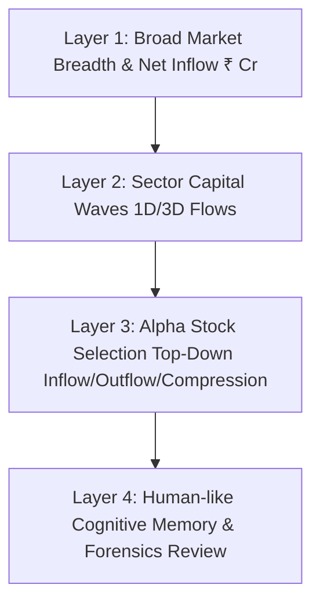

# 🧠 GIDH BRAIN 1: PRE-MARKET MACRO SELECTOR

---

## 1. Role & Mandate
**Brain 1 (Macro Selector)** is an autonomous pre-market institutional surveillance engine. Its sole responsibility is to evaluate market structure **before 09:15 AM IST** and emit the day's **Focus Trading Universe**:

1. **Focus Bulls**: Top stocks with verified institutional capital inflow and unexhausted ADR range fuel (`fuel_pct > 30%`) in leading sectors.
2. **Focus Bears**: Top breakdown candidates with heavy capital outflow and compressed resistance in lagging sectors.
3. **Exhaustion / Trap List**: High-volume stocks that have already burned their range fuel (`fuel_pct < 20%`) (blacklisted from long buys).

Once the focus universe is emitted, **Brain 1 hands off to the Micro Brains and finishes its pre-market duties**.

---

## 2. Top-Down 4-Layer Hierarchy



1. **Layer 1: Broad Market Breadth & Net Inflow (₹ Cr)**: Classify broad market regime.
2. **Layer 2: Sector Capital Waves**: Rank sectors by net 1D/3D institutional inflows to isolate leading accumulation vs bleeding distribution sectors.
3. **Layer 3: Alpha Stock Selection (Universe: ₹300 – ₹7,000)**: Select 2-4 high-fuel longs in leading sectors, 2-3 high-fuel shorts in lagging sectors, and blacklist 0% fuel climax traps.
4. **Layer 4: Distilled Cognitive Memory**: Store actionable bullet points (`market_regime`, `active_campaigns`, `learned_rules`, `traps_to_avoid`) in `quant.brain_memory`.

---

## 3. Sensory Tools

Brain 1 utilizes 4 dedicated sensory tools located in `quant/brains/macro_brain/tools/`:

- **Tool 0 (`market_macro_sensor.py`)**:
  - Universe Net 1D/3D Inflow (₹ Cr)
  - Universe Advances / Declines & Breadth %
  - Sector Capital Rotation Waves (Ranked 1D/3D flows, sector advance/decline ratio)
- **Tool 1 (`futures_sensor.py`)**:
  - 1D, 3D, 5D Fresh Capital Inflow ($\Delta \text{OI} \times \text{Price}$ in ₹ Crores)
  - Futures Price $\Delta\%$ & OI $\Delta\%$
- **Tool 2 (`structure_sensor.py`)**:
  - CPR Width % ($|\text{TC} - \text{BC}| / \text{Pivot} \times 100$)
  - 20 / 50 / 200 Day Moving Averages
  - 3-Day Range vs 20-Day ADR (Macro Fuel %)
  - Price filter: ₹300 to ₹7,000 INR
- **Tool 3 (`review_tool.py`)**:
  - Actual cash market execution outcomes on Date $T+1$ (Open, High, Low, Close)
  - Gap %, Max Intraday Expansion (MFE), Max Drawdown (MAE), EOD Net %
  - Trap Fade % (Performance vs Open)

---

## 4. The 3-Stage Daily Lifecycle

```
[08:30 AM Pre-Market]
  Tools 0, 1, 2 -> Raw Sensory Packet -> AI Evaluates -> Saves to `quant.brain_sessions`
                                                        │
                                                        ▼
[09:15 AM - 03:30 PM Intraday]
  Micro Brains trade the Focus Universe using 1-minute order flow
                                                        │
                                                        ▼
[03:45 PM Post-Market EOD]
  Tool 3 (Review Tool) measures actual outcomes -> AI writes EOD Forensics -> Updates `quant.brain_memory`
```

---

## 5. How to Run & Verify

```bash
# 1. Ingest sensory packet and view top candidates:
./.venv/bin/python quant/towncenter.py macro <YYYY-MM-DD>

# 2. Check rolling memory state:
./.venv/bin/python quant/towncenter.py memory --brain macro_selector

# 3. Record decisions directly via CLI:
./.venv/bin/python quant/brains/macro_brain/runner.py <YYYY-MM-DD> --mode record \
  --regime "REGIME_LABEL" \
  --leader "LEADING_SECTOR" \
  --lagger "LAGGING_SECTOR" \
  --bulls SYMBOL1 SYMBOL2 \
  --bears SYMBOL3 SYMBOL4 \
  --traps TRAP1 TRAP2 \
  --thesis "Cognitive thesis narrative..."

# 4. Review outcomes post-market:
./.venv/bin/python quant/brains/macro_brain/runner.py <PRIOR_DATE> --mode review --outcome-date <OUTCOME_DATE> --forensics "Learnings..."
```
