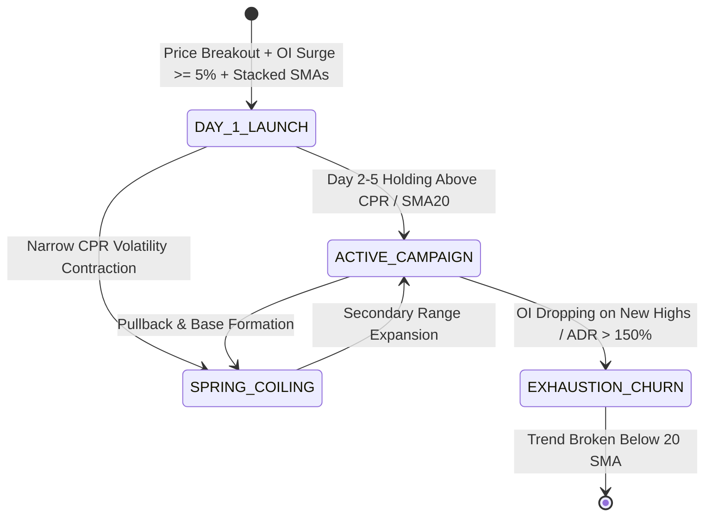

# 📊 Institutional Campaign State Machine & Microstructural Playbook

This document details the quantitative mechanics of institutional campaign tracking in Indian equities (NSE F&O).

---

## 1. Why Campaign Tracking Trumps Single-Day Technical Analysis
Retail traders analyze 1-minute or 5-minute candles as isolated events. Institutional algorithms do not operate on a 5-minute horizon; they execute multi-day accumulation and distribution campaigns that take 3 to 10 trading sessions to complete due to large order book impact.

By classifying each stock into an active **Campaign State**, we trade with an institutional tailwind rather than guessing intraday chop.

---

## 2. The 4 Campaign States

### 1. `DAY_1_BULL_LAUNCH` / `DAY_1_BEAR_LAUNCH`
- **Quantitative Definition**:
  - Futures OI 1-Day Change $\ge +5.0\%$
  - Futures Price Move $\ge +1.0\%$ (Longs) or $\le -1.0\%$ (Shorts)
  - Distance to 20-Day High/Low $\le 4.0\%$
  - Triple Moving Average Stack ($>\text{SMA}_{20} \ge \text{SMA}_{50} > \text{SMA}_{200}$)
- **Intraday Strategy**: Enter aggressively on 09:16–09:25 AM ORB / Prior Day High breakouts while ADR Fuel used is $< 50\%$.

### 2. `ACTIVE_BULL_CAMPAIGN` / `ACTIVE_BEAR_CAMPAIGN`
- **Quantitative Definition**:
  - 5-Day Cumulative Return $> +2.0\%$ (Longs) or $< -2.0\%$ (Shorts)
  - Stock holding above $\text{SMA}_{20}$ and yesterday's Point of Control (POC)
- **Intraday Strategy**: Do not chase initial gap opens. Wait for morning mean-reversion dip to VWAP / Prior Day High support, then ride the continuation.

### 3. `BULL_SPRING_COILING` / `BEAR_SPRING_COILING`
- **Quantitative Definition**:
  - Narrow Central Pivot Range (CPR Width $\le 0.30\%$)
  - Range contracting near 20-Day High/Low with steady Futures OI
- **Intraday Strategy**: Stand by for volatility expansion; trigger entry on the first 5-min candle that breaks out with RVOL $\ge 1.2x$.

### 4. `EXHAUSTION_CHURN`
- **Quantitative Definition**:
  - Price pushes higher but Futures OI declines $> 3.0\%$ (Long Unwinding)
  - Stock has moved $> 12\%$ over 5 days with ADR fuel $> 120\%$
- **Intraday Strategy**: Prohibit Long entries. Tighten trailing stops or look for mean-reversion exhaustion fades.

---

## 3. The Fuel Gate Equation (`adr_fuel_used_pct`)

The single most important microstructural safeguard discovered in our live and historical data is the **Fuel Gate**:

$$\text{ADR Fuel Used \%} = \frac{\text{Session High} - \text{Session Low}}{\text{ADR}_{20}} \times 100$$

- **Rule**: If $\text{ADR Fuel Used} \ge 50\%$ before entry trigger, **REJECT THE TRADE**.
- **Reasoning**: Entering after $50\%$ of daily ADR is consumed buys an overextended move with high probability of rubber-band mean reversion back to the VWAP / Castle POC.
