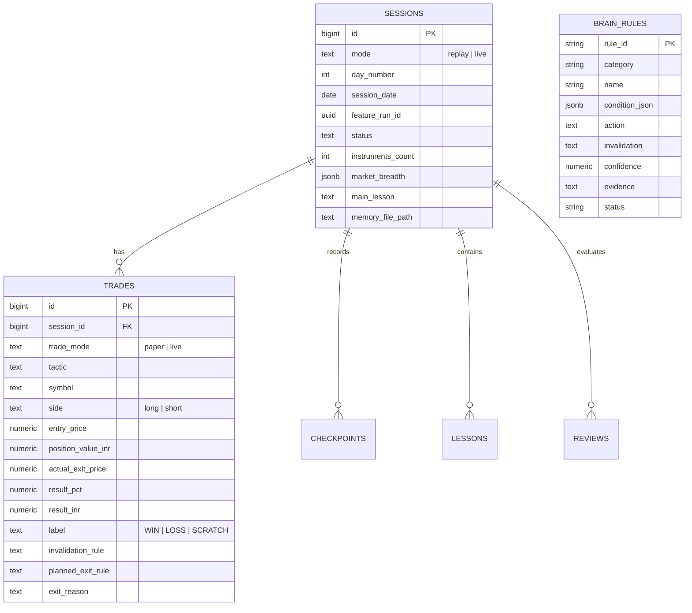

# Database Schema & Business Intelligence Specification

This document details the PostgreSQL / TimescaleDB schema for the `quant.*` namespace in `gidh_intraday`.

---

## 1. Schema Overview



---

## 2. Core Tables

### `quant.sessions`
Records daily session meta, total breadth, and high-level retrospective notes.

```sql
CREATE TABLE IF NOT EXISTS quant.sessions (
    id BIGSERIAL PRIMARY KEY,
    mode TEXT NOT NULL CHECK (mode IN ('replay', 'live')),
    day_number INTEGER,
    session_date DATE NOT NULL,
    feature_run_id UUID,
    status TEXT NOT NULL DEFAULT 'draft',
    instruments_count INTEGER,
    bars_per_instrument INTEGER,
    market_breadth JSONB,
    main_lesson TEXT,
    next_question TEXT,
    memory_file_path TEXT,
    created_by TEXT NOT NULL DEFAULT 'antigravity',
    created_at TIMESTAMPTZ NOT NULL DEFAULT now(),
    updated_at TIMESTAMPTZ NOT NULL DEFAULT now(),
    CONSTRAINT uq_sessions_mode_date_day UNIQUE (mode, session_date, COALESCE(day_number, -1))
);
```

### `quant.trades`
Records individual trade entries, checkpoints, exits, and P&L results.

```sql
CREATE TABLE IF NOT EXISTS quant.trades (
    id BIGSERIAL PRIMARY KEY,
    session_id BIGINT NOT NULL REFERENCES quant.sessions(id) ON DELETE CASCADE,
    trade_mode TEXT NOT NULL CHECK (trade_mode IN ('paper', 'live')),
    tactic TEXT NOT NULL,
    symbol TEXT NOT NULL,
    side TEXT NOT NULL CHECK (side IN ('long', 'short')),
    entry_checkpoint_minute INTEGER,
    entry_time_label TEXT,
    entry_price NUMERIC NOT NULL,
    position_value_inr NUMERIC NOT NULL DEFAULT 10000,
    quantity NUMERIC,
    invalidation_rule TEXT,
    estimated_max_loss_inr NUMERIC,
    planned_exit_rule TEXT,
    actual_exit_checkpoint_minute INTEGER,
    actual_exit_time_label TEXT,
    actual_exit_price NUMERIC,
    exit_reason TEXT,
    result_pct NUMERIC,
    result_inr NUMERIC,
    label TEXT CHECK (label IN ('WIN', 'LOSS', 'SCRATCH', 'GOOD_LOSS', 'BAD_WIN')),
    live_order_ref TEXT,
    raw_entry JSONB,
    raw_exit JSONB,
    created_at TIMESTAMPTZ NOT NULL DEFAULT now(),
    updated_at TIMESTAMPTZ NOT NULL DEFAULT now()
);
```

### `quant.brain_rules`
Stores the distilled, opinionated Operating Brain rules with confidence scores, executable condition JSON, and promotion evidence.

```sql
CREATE TABLE IF NOT EXISTS quant.brain_rules (
    rule_id VARCHAR(64) PRIMARY KEY,
    category VARCHAR(32) NOT NULL, -- ENTRY, INVALIDATION, HOLD, NO_TRADE, ALLOCATION, CHARACTER, BATTALION
    name VARCHAR(128) NOT NULL,
    condition_json JSONB NOT NULL,
    action TEXT NOT NULL,
    invalidation TEXT,
    confidence NUMERIC(4,2) NOT NULL,
    evidence TEXT NOT NULL,
    status VARCHAR(16) NOT NULL DEFAULT 'ACTIVE',
    created_at TIMESTAMPTZ DEFAULT NOW(),
    updated_at TIMESTAMPTZ DEFAULT NOW()
);
```

---

## 3. Standard Business Intelligence Queries

### Cumulative Portfolio Performance
```sql
SELECT 
    count(id) as total_trades,
    sum(result_inr) as cumulative_inr,
    round(avg(result_pct)::numeric, 2) as overall_avg_trade_pct,
    count(*) filter (where label = 'WIN') as wins,
    count(*) filter (where label = 'LOSS') as losses,
    count(*) filter (where label = 'SCRATCH') as scratches
FROM quant.trades;
```

### Performance by Tactic
```sql
SELECT 
    tactic,
    count(*) as trades,
    round(sum(result_inr)::numeric, 2) as total_inr,
    round(avg(result_pct)::numeric, 2) as avg_return_pct,
    round((count(*) filter (where label = 'WIN')::numeric / count(*)) * 100, 1) as win_rate_pct
FROM quant.trades
GROUP BY tactic
ORDER BY total_inr DESC;
```
